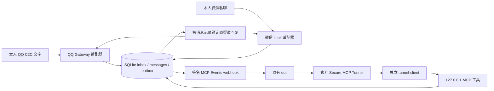

# dot-im-gateway

让**同一个已有 OpenAI dot** 接收 QQ / 微信本人私聊任务，并向原渠道回复。网关负责身份、消息、队列和媒体，不执行任务，不创建 Agent，不调用模型 API，不访问未公开的 dot 内部接口。

首版 `0.1.0`：Linux 单机、Node.js 24.21+（24 系列）、SQLite、loopback HTTP MCP、独立官方 tunnel-client、systemd 用户服务。没有 npm 运行依赖。Windows 可开发和运行离线测试；正式部署脚本只接受 Linux。

**验收状态：本项目的离线、模拟和本地回环测试是开发验证。真实原 dot、Tunnel、QQ/微信账号及真人接收均待用户环境验收。** 默认 `mode=offline`，平台关闭，订阅门关闭。安装不扫码、不生成账号凭据、不创建 Tunnel、不创建真实订阅。

## 消息路径



## 能力与边界

| 能力 | QQ | 微信 |
|---|---|---|
| 本人文字私聊收/发 | 实现，待真人验收 | 实现，待真人验收 |
| 本人稳定身份绑定 | `user_openid` + bot App ID | `from_user_id` + `to_user_id` bot ID |
| ack / final | 被动回复 `msg_id` / `msg_seq=1,2` | 原消息 `context_token`，每条一个 item |
| 入站图片/PDF | **不支持，拒绝附件** | PNG/JPEG/PDF，实现 CDN 解密和模拟测试 |
| 出站图片/PDF | 首版不支持 | 单个 final 附件，实现加密上传和模拟测试 |
| 主动推送任意会话 | 不支持 | 不支持；必须有原消息 context 和有效期限 |
| 送达/已读保证 | 无；只记录服务端接受 | 无；只记录服务端接受 |
| 群聊/其他人/语音通话 | 不支持 | 不支持 |

微信单文件最大 4 MiB（低于 Tunnel 完整 envelope 10 MiB 限制）；默认总媒体配额 256 MiB、保留 7 天。媒体只接受不透明 ID 或有界 base64 字节，不接受服务器路径或任意 URL。图片/PDF 检查文件头和类型，**不保证文件无恶意内容，也不自动打开执行**。暂不支持多附件 final、文字+附件合并 final、音频/视频和全量历史镜像。

QQ 被动回复窗口本地默认 4 分钟，最高 5 分钟，实际服务端可能更严格。微信本地最长保留回复资格 24 小时，但不把它当作服务端承诺；无效 context 会被拒绝。两个平台都不会因任务耗时超过窗口而改用另一渠道。

## 离线快速开始

```sh
node --version                    # 24.21.0 或更高的 24.x
npm ci --offline --ignore-scripts
npm test
npm run check
node bin/gateway.js config init --config config.json
node bin/gateway.js doctor --config config.json
node bin/gateway.js status --config config.json
```

`npm ci` 只有本包，零第三方 npm 依赖。测试使用合成身份/密钥和临时目录；回环测试会临时监听 `127.0.0.1` 随机端口，不调用外部平台。受限沙箱若阻止回环连接，应在允许本地回环的测试环境运行，不能跳过后宣称通过。

要启动离线服务，在本地安全环境中提供长度至少 32 字符的 `DOT_GATEWAY_TOKEN`，然后执行 `node bin/gateway.js serve --config config.json`。令牌值不要放到命令参数、聊天或 Git。离线模式不会启动真实平台轮询或发送 webhook。正式部署按 [部署手册](docs/DEPLOYMENT.md) 和 [部署 Skill](skills/deploy-dot-im-gateway/SKILL.md) 的交互关卡操作。

## MCP 工具

采用 [官方 MCP Events](https://developers.openai.com/plugins/build/mcp-events) 要求的 `2026-07-28` 协议：`server/discover`、`tools/list`、`tools/call`、`events/list/subscribe/unsubscribe`。仅 POST `/mcp`，Bearer 鉴权；每个请求带协议 `_meta` 和匹配的 `MCP-Protocol-Version` / `Mcp-Method` / `Mcp-Name`。不伪装支持旧版 `initialize`。

| 工具 | 用途 |
|---|---|
| `gateway_status` | 脱敏队列数量 |
| `list_pending` | 每页 50 条可处理或待核实消息，返回 `messages` 与 `next_cursor`；传入 cursor 继续，排除过期、终止和停用平台记录 |
| `read_message` | 读取消息及 ack/final 状态 |
| `reply` | 固定消息 ID + `ack` 或 `final`；不能指定收件人或平台 |
| `put_media` | 为某条微信消息保存 PNG/JPEG/PDF base64 |
| `read_media` | 返回消息所属图片或嵌入 PDF 资源 |

事件仅携带 `message_id` 和 `platform`，不包含指挥 dot 行为的文字。原 dot 需要用户明确订阅并设定：收到后读消息、尽快 `reply(ack)`，执行任务后 `reply(final)`，用 `read_message` 检查实际发送状态。网关不替 dot 决定或执行任务。

回复唯一键是 `(message_id, phase)`；相同内容重复调用安全，内容不同报冲突。`final` 要等 `ack` 被平台接受才发送。`pending` 表示排队，`accepted` 表示接口接受，`uncertain` 表示可能已发送，不能盲目重发。人工核实后使用 CLI reconcile。详见 [架构](docs/ARCHITECTURE.md)、[安全边界](docs/SECURITY.md)。

ack 被明确拒绝或取消时，其排队 final 会取消；ack 为 uncertain 时 final 等待人工核实，但不阻塞其他消息，超过回复窗口即终止。入站瞬时故障采用持久化指数退避（1 秒至 5 分钟），停用平台不占处理名额。附件按同一消息的类型和完整字节复用，不因多附件部分下载失败反复占用配额。

## 运维与交付

- `config init`、`doctor`、`status`、`logs`、`backup`、`restore`、`reconcile`、`upgrade`、`rollback`、`uninstall`：见 [运维手册](docs/OPERATIONS.md)。
- 可重复部署与升级脚本：`python3 scripts/deploy.py --help`，默认只输出计划；卸载保留数据、配置、凭据、备份和历史版本。
- 官方 tunnel-client 单独下载安装与运行；不捆绑、不改写它的控制协议。
- 上游固定版本、许可证与借鉴内容：[第三方声明](THIRD_PARTY_NOTICES.md)、[参考审查](docs/UPSTREAM.md)、`references.lock.json`。
- 本地及 CI 证据：[验证记录](docs/VALIDATION.md)。下一阶段逐项完成 [用户环境验收清单](docs/ACCEPTANCE.md)。

本项目独立开发，不隶属或获 OpenAI、腾讯、Nous Research 背书。源代码 MIT 不改变平台使用条款、第三方依赖及官方客户端的许可边界。
