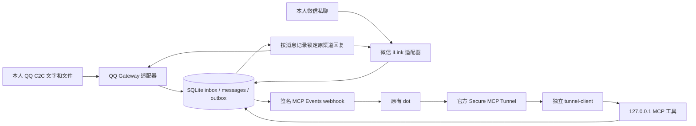

# dot-im-gateway

让**同一个已有 OpenAI dot** 接收 QQ / 微信本人私聊任务，并向原渠道回复。网关负责身份、消息、队列和媒体，不执行任务，不创建 Agent，不调用模型 API，不访问未公开的 dot 内部接口。

## 两种用法

| | 服务器常驻（推荐） | Windows 一次性 |
|---|---|---|
| 适合 | 有一台能 SSH 登录的 Linux x64 服务器 | 只有一台 Windows 电脑，临时用 |
| 在线 | 7×24；崩溃自动重启、断网自动重连、开机自启 | 窗口开着才在线；睡眠、关机或关窗口即断开 |
| 来消息 | 通过 MCP Events **自动叫醒** dot | 需要你主动让 dot 去查看 |
| 凭据 | 保存在服务器上仅本用户可读的文件（0600） | 只在内存，关闭即清理 |
| 绑定 | 单文件程序 `--handoff`：扫码绑定一次，结果移交常驻服务 | 单文件程序直接连接 |

[单文件连接程序](docs/PORTABLE.md)只是**一次性入口**（扫码、确认本人、填 Tunnel），用户不用装 Node、Python 或 npm；**常驻服务**（SQLite + systemd 用户服务 + 官方 tunnel-client）负责长期运行。两者共用同一套源码模块。

## 交给 Agent 一句话搞定

把下面对应模式的指令发给能操作终端的 Agent（例如 Codex），不用另装 Skill 包。Agent 会自动判断自身具备的权限并执行最佳路线（或者指定 Plan A / B / C）：

- **Plan A（全授权全自动，小白只扫码）**：
  > 适合具备「终端/SSH + 已登录浏览器页面代点（Browser / Playwright）」权限的 Agent：
  ```text
  请按这个 Skill 执行 Plan A 全自动帮我把 QQ/微信接入已有的 dot：自动部署服务器、在浏览器建好 Tunnel 与受限 Key、打开连接页，我只需手机扫码；交接后自动在 ChatGPT 添加插件并订阅，最后提醒我发「你好」验收：https://github.com/Flysky701/dot-im-gateway/blob/main/skills/connect-dot-im-gateway/SKILL.md
  ```

- **Plan B（半自动跳页领航，小白只点确定/复制/扫码）**：
  > 适合具备「终端/SSH + 打开本机浏览器/写剪贴板」权限的 Agent：
  ```text
  请按这个 Skill 执行 Plan B 帮我把 QQ/微信接入已有的 dot：你来部署服务器，帮我依次弹出 Tunnels、API Keys 与连接页面，我填两项并扫码；交接后自动弹出 ChatGPT 插件页并把名称和订阅指令写入剪贴板，我按提示粘贴完成：https://github.com/Flysky701/dot-im-gateway/blob/main/skills/connect-dot-im-gateway/SKILL.md
  ```

- **Plan C（服务器代配 + 极简分步向导）**：
  > 适合仅具备服务器 SSH 权限、无法操控用户电脑浏览器的 Agent：
  ```text
  请按这个 Skill 在我的服务器 <SSH 别名> 上执行 Plan C 部署 dot-im-gateway：全程你来操作并监控状态，每次只给我一步极简提示，需要我本地转发、扫码或在 ChatGPT 填通道时再叫我：https://github.com/Flysky701/dot-im-gateway/blob/main/skills/deploy-dot-im-gateway/SKILL.md
  ```

只需两步准备：① 在 OpenAI Platform 创建或复用关联 ChatGPT 工作区的 Tunnel，② 创建仅带 `Tunnels: Read + Use` 的 Restricted 密钥（直接填入连接页，不发聊天，无需组织 ID）。移交常驻服务后，连接页会**实时显示 ChatGPT 插件连通和事件订阅的对勾清单**！

## 自己动手（服务器）

```sh
git clone https://github.com/Flysky701/dot-im-gateway && cd dot-im-gateway
bash scripts/server-bootstrap.sh       # 装固定版本 Node、常驻服务和单文件程序；不接触任何账号凭据
sudo loginctl enable-linger "$USER"    # 可选但推荐：退出登录后、开机后仍运行
# 在自己电脑上（把 <next> 换成上一步输出 JSON 里的 next 命令）：
ssh -L 127.0.0.1:8789:127.0.0.1:8789 <服务器> '<next>'
```

打开终端里显示的链接 → 选平台、填 Tunnel 两项（通道编号与受限密钥）、手机扫码 → 页面显示实时状态清单（等待 ChatGPT 插件连通与事件订阅）。之后用 `bash scripts/server-status.sh` 查看状态（一行 JSON，`"ok": true` 即正常）。详见 [部署手册](docs/DEPLOYMENT.md)。

## 出问题怎么办

| 情况 | 系统会怎样 | 你要做什么 |
|---|---|---|
| 断网，QQ / 微信 / Tunnel 暂时不可用 | 常驻服务自动退避重连 | 无 |
| 服务崩溃 | systemd 自动重启 | 无 |
| 服务器重启 | 开机自启（需已开启 linger） | 无 |
| 凭据失效、机器人重置、微信登录过期 | 记录错误类别，该平台停止收发 | 让 Agent 重新运行 handoff 扫码；Tunnel 两项留空即沿用 |
| 想再加一个平台 | — | 再运行一次 handoff，选另一个平台 |
| 想换绑另一个人或机器人 | 同一数据目录拒绝换人，防止消息发错人 | 卸载后用新目录重装 |
| 回复显示 `uncertain` | 不自动重发 | 核对聊天记录后用 `reconcile` 处理，见 [运维手册](docs/OPERATIONS.md) |
| Windows 一次性模式断开 | — | 重新运行程序 |

**验收状态：2026-10-22 原 dot 经私人 Tunnel 完成 QQ、微信本人文字的手动 ack/final 往返，用户分别确认客户端实收。** [脱敏验收记录](docs/TEXT_ACCEPTANCE_2026-10-22.md)。该结果来自此前受限测试程序；单文件入口、`--handoff` 移交常驻服务、Events 自动唤醒、微信媒体真人收发和真实故障恢复已通过离线/合成测试，仍待真人验收。新安装默认 `mode=offline`、平台关闭、订阅门关闭；handoff 成功后才切到 live 并开启订阅。

## 消息路径（模块化服务；便携入口关闭 Events）



## 能力与边界

| 能力 | QQ | 微信 |
|---|---|---|
| 本人文字私聊收/发 | 旧受限测试入口已由原 dot 往返并确认实收；新 portable 入口待真人验收 | 旧受限测试入口已由原 dot 往返并确认实收；新 portable 入口待真人验收 |
| 本人稳定身份绑定 | `user_openid` + bot App ID | `from_user_id` + `to_user_id` bot ID |
| 自然回复 / 可选进度 | 默认一条 final，`msg_seq=1`；有 ack 时 final 用 2 | 默认一条 final，使用原消息 `context_token` |
| 连续短句 | 默认安静 2 秒后合并，最长等 8 秒 | 同左；两平台分别处理 |
| 入站文件 | 图片、PDF、文本和普通文件；失败状态单独返回，已离线验证 | PNG/JPEG/PDF，实现 CDN 解密和模拟测试 |
| 出站文件 | 单个 final 文件，先上传再发送；已离线验证，待真人验收 | 单个 final 图片/PDF，实现加密上传和模拟测试 |
| 文件检查 | 文件名、大小、类型、SHA256、有限 UTF-8 预览 | 元信息；图片/PDF 内容通过 read_media 读取 |
| 本人主动文字通知 | 已实现，平台权限待实测；不能发任意会话 | 实验性 none/latest，平台接受与手机收件待实测 |
| 送达/已读保证 | 无；只记录服务端接受 | 无；只记录服务端接受 |
| 群聊/其他人/语音通话 | 不支持 | 不支持 |

QQ/微信单文件最大 4 MiB（低于 Tunnel 完整 envelope 10 MiB 限制）；默认总媒体配额 256 MiB、保留 7 天。媒体只接受不透明 ID 或有界 base64 字节，不接受服务器路径或任意 URL。图片/PDF 检查文件头和类型，**不保证文件无恶意内容，也不自动打开执行**。暂不支持多附件 final、文字+附件合并 final、音频/视频播放解析和全量历史镜像。QQ 普通二进制可以收发，但 Office/压缩包等不会由网关解析，详见[QQ 文件](docs/QQ_MEDIA.md)。

QQ 被动回复窗口本地默认 4 分钟，最高 5 分钟，实际服务端可能更严格。微信本地最长保留回复资格 24 小时，但不把它当作服务端承诺；无效 context 会被拒绝。两个平台都不会因任务耗时超过窗口而改用另一渠道。

## 离线快速开始

已有官方 QQ 机器人时，可在明确批准测试范围后使用 [QQ 本人文字限时测试入口](docs/QQ_PRIVATE_TEST.md)；微信使用[官方扫码限时入口](docs/WEIXIN_PRIVATE_TEST.md)。两者只开放四个文字工具，最长 30 分钟，退出清理本轮数据。QQ 使用一次性挑战加独立终端确认；微信绑定官方扫码 confirmed 返回的稳定 ID。两者已完成本次本人文字真人验收，不代表任意账号准入或生产部署通过。

```sh
node --version                    # 24.21.0 或更高的 24.x
npm ci --offline --ignore-scripts
npm test
npm run check
node bin/gateway.js config init --config config.json
node bin/gateway.js doctor --config config.json
node bin/gateway.js status --config config.json
```

`npm ci` 只有本包，零第三方 npm 依赖。测试使用合成身份/密钥和临时目录；回环测试会临时监听 `127.0.0.1` 随机端口，不调用外部平台。受限沙箱若阻止回环连接，应在允许本地回环的测试环境运行，不能跳过后宣称通过。

要启动离线服务，在本地安全环境中提供长度至少 32 字符的 `DOT_GATEWAY_TOKEN`，然后执行 `node bin/gateway.js serve --config config.json`。令牌值不要放到命令参数、聊天或 Git。离线模式不会启动真实平台轮询或发送 webhook。正式部署按 [部署手册](docs/DEPLOYMENT.md) 和 [部署 Skill](skills/deploy-dot-im-gateway/SKILL.md) 的交互关卡操作。

## MCP 工具

采用 [官方 MCP Events](https://developers.openai.com/plugins/build/mcp-events) 要求的 `2026-07-28` 协议：`server/discover`、`tools/list`、`tools/call`、`events/list/subscribe/unsubscribe`。仅 POST `/mcp`，Bearer 鉴权；每个请求带协议 `_meta` 和匹配的 `MCP-Protocol-Version` / `Mcp-Method` / `Mcp-Name`。不伪装支持旧版 `initialize`。

| 工具 | 用途 |
|---|---|
| `gateway_status` | 脱敏队列数量 |
| `list_pending` | 每页 50 条可处理或待核实消息，返回 `messages` 与 `next_cursor`；传入 cursor 继续，排除过期、终止和停用平台记录 |
| `read_message` | 读取一轮合并后的短句、原消息 ID 列表及回复状态 |
| `reply` | 默认直接 final；可选 ack 仅用于耗时任务进度，不能指定收件人或平台 |
| `notify_owner` | 向已绑定本人主动发送文字；QQ 无入站 msg_id，微信明确选择实验性 none/latest 上下文模式 |
| `notification_status` | 按通知 ID 查询 queued/accepted/rejected/uncertain、尝试次数及时间，不返回正文或身份 |
| `message_timing` | 查询接收、事件、dot 读取和 ack/final 阶段时间；不把处理总耗时称为纯思考时间 |
| `put_media` | 保存回复文件 base64；QQ 提供 filename，微信仍限 PNG/JPEG/PDF |
| `inspect_media` | 查询文件元信息、SHA256 和有限文本预览 |
| `read_media` | 返回消息所属图片或嵌入文件资源 |

事件仅携带 `message_id` 和 `platform`，不包含指挥 dot 行为的文字。原 dot 需要用户明确订阅并设定：收到后读消息，将批次作为一轮正常对话，只向返回的 `id` 回复一次。默认不发固定“收到”，只有耗时任务才按需发进度 ack。用 `read_message` 检查发送状态。网关不替 dot 决定或执行任务。

回复唯一键是 `(批次根 message_id, phase)`；相同内容重复调用安全，内容不同报冲突。省略 phase 即 final，不要求 ack；若已经排队 ack，仍按原顺序等待其被接受。final 排队后不能再补发 ack。`pending` 表示排队，`accepted` 表示接口接受，`uncertain` 表示可能已发送，不能盲目重发。人工核实后使用 CLI reconcile。详见 [对话流程](docs/CONVERSATION.md)、[架构](docs/ARCHITECTURE.md)、[安全边界](docs/SECURITY.md)。

主动通知是常驻服务的新入口，不依赖上述回复唯一键，也不创建提醒计划。由 Agent 的既有定时能力在指定时间调用，每次逻辑通知固定一个 `idempotency_key`。QQ 平台主动权限/额度和微信无上下文接受能力仍需用户实测，代码不能解除平台限制；`accepted` 也不等于手机送达。参数、可复制提示词、限速及延迟解释见[主动通知与延迟观测](docs/NOTIFICATIONS.md)。Windows 一次性和私聊测试入口仍仅开放原有四个文字工具。

ack 被明确拒绝或取消时，其排队 final 会取消；ack 为 uncertain 时 final 等待人工核实，但不阻塞其他消息，超过回复窗口即终止。入站瞬时故障采用持久化指数退避（1 秒至 5 分钟），停用平台不占处理名额。附件按同一消息的类型和完整字节复用，不因多附件部分下载失败反复占用配额。

## 运维与交付

- `config init`、`doctor`、`status`、`logs`、`backup`、`restore`、`reconcile`、`upgrade`、`rollback`、`uninstall`：见 [运维手册](docs/OPERATIONS.md)。
- 可重复部署与升级脚本：`python3 scripts/deploy.py --help`，默认只输出计划；卸载保留数据、配置、凭据、备份和历史版本。
- 官方 tunnel-client 内置在单文件程序中（SHA256 校验）。一次性模式作为子进程运行；`--handoff` 时安装到 `prefix/bin/tunnel-client`，由 `dot-im-tunnel.service` 常驻运行，不改写它的控制协议。
- 发布：推送 `v*` 标签后，[release 工作流](.github/workflows/release.yml) 在干净环境测试、构建 Windows / Linux 单文件并附上 `.sha256`，生成**草稿** Release，由维护者审核后发布。单文件内含标注为 UNLICENSED 的腾讯 QQ SDK，公开发布二进制前请先确认再分发许可，见[第三方声明](THIRD_PARTY_NOTICES.md)。
- 上游固定版本、许可证与借鉴内容：[第三方声明](THIRD_PARTY_NOTICES.md)、[参考审查](docs/UPSTREAM.md)、`references.lock.json`。
- 本地及 CI 证据：[验证记录](docs/VALIDATION.md)。下一阶段逐项完成 [用户环境验收清单](docs/ACCEPTANCE.md)。

本项目独立开发，不隶属或获 OpenAI、腾讯、Nous Research 背书。源代码 MIT 不改变平台使用条款、第三方依赖及官方客户端的许可边界。
