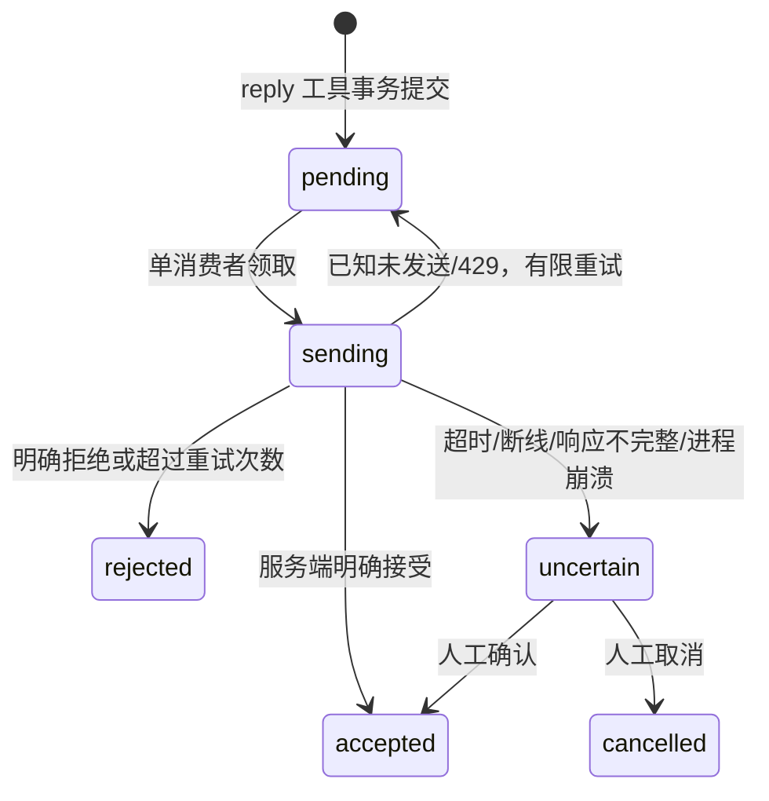

# 架构和可靠性语义

`config.js` 严格白名单配置；`network.js` 负责出站 HTTPS 域名白名单、公共 IPv4 DNS 检查和连接 IP 固定；`adapters/` 实现各平台协议；`store.js` 管持久状态；`core.js` 管处理与回复；`events.js` 管订阅；`server.js` 实现 MCP 2.0；`runtime.js` 运行独立循环和单实例锁。

SQLite WAL + synchronous FULL，单机单实例。Linux 使用抽象 Unix socket 锁，进程死亡由操作系统释放；Windows 测试使用命名管道。两个进程不能同时消费同一数据目录。HTTP 并发与工作循环分开，但所有数据库事务都是同步短事务，网络请求不放在事务内。

## 入站

QQ Gateway 使用公开 WSS 协议：HELLO、identify/resume、heartbeat/ACK、READY、序号检查点、断线退避。只订阅所需 C2C intent，但仍逐条拒绝群聊和非本人事件。私有 inbox 写入与 seq 更新同一事务，重放用 `(platform, source ID)` 去重。无服务器历史重放保证；QQ 不可恢复的 session 间隙只能在真人验收中确认。网关不声称能找回平台从未交付的消息。

微信 `getupdates` 批次与 `get_updates_buf` 同事务保存。只保存匹配 owner/bot 的完整本人消息；媒体下载在持久 inbox 之后进行，失败不会丢失 cursor 前的包。无效格式进入 rejected，网络失败留待重试。原始包在成功/明确拒绝后清空；规范化消息只保留任务所需信息与原会话 context。

消息落库与为已有活跃订阅创建 event outbox 是一个事务。无订阅时也保留消息；新订阅/续期补发未完成消息的应用通知。事件 `cursor:null`，不声称实现协议历史 replay；外部中断期间未收到的上游消息不在恢复范围内。`list_pending` 可供用户要求原 dot 检查积压。

## 回复

每轮最多一个可选进度 ack 和一个 final，默认直接 final。已选择发送 ack 时，完成前 final 保持 pending，取消 ack 会阻止 final；final 排队后不能再插入 ack。内容不可修改以免重放漂移。短句按[对话流程](CONVERSATION.md)持久化合并，批次只触发一次事件，回复使用该批次最新原消息的渠道凭据。配置切换身份时已有数据目录拒绝启动；禁用平台时停止发送。没有跨平台广播或收件人参数。

平台发送不是通用 exactly-once 操作。队列提供持久去重、写工具幂等和保守的不确定状态；不能保证外部平台绝不重复或绝不丢失。`accepted` 不是真人送达/已读，也不是原 dot 执行成功。

## 事件

订阅 ID 为 principal + URL + 事件名 + canonical arguments 的哈希。验证 callback challenge 后启用。secret 解码要求 24–64 字节，Standard Webhooks HMAC 覆盖稳定 event ID、当次签名时间和原始发送字节。续期保留 ID；新旧 secret 轮换 5 分钟双签；过期停止发送，撤销清空密钥。HTTP 410 撤销，413 终止该事件；瞬时错误最多 8 次指数退避，超限 dead 供排查。已发出但未完成的撤销请求可能仍有一条在途 HTTP 包，不能撤回已经送达的内容。

私有媒体以 UUID 文件保存，权限 0600，目录 0700，关联 message ID。媒体清理保留 pending/sending/uncertain 回复所需文件。SQLite/媒体备份要求停服务，恢复只写新目录，pending/sending 回复变 uncertain、订阅撤销，避免从旧快照无声重复发送。

本服务没有全量历史归档/索引。去重 tombstone 和任务文本当前保留在 SQLite 中，操作员通过备份/新数据目录管理保留期；不自动删除去重键以免重放成为新任务。首次版本使用者需关注数据库磁盘容量。
